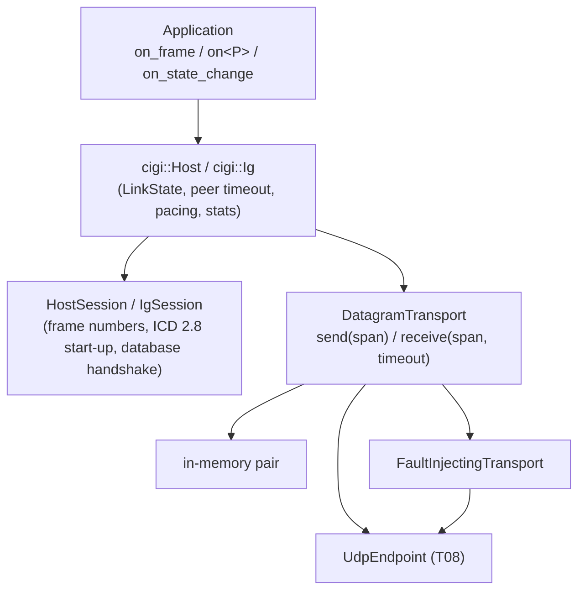

# 04 - Host and IG sessions (T07)

Scope: `cigi::HostSession`, `cigi::IgSession` in the `cigi_session` target (`cigi::session`;
spdlog, no Boost, no sockets). A session owns the protocol state of one peer relationship; the
transport (T08) and the facade (T09a) only move bytes and decide when to call it. Not thread-safe:
one session per thread.

## What a session does

```mermaid
sequenceDiagram
    participant H as HostSession
    participant I as IgSession
    I->>H: Start of Frame (IG frame n, mode Standby)
    Note over H: record peer version and byte order; track n; ready_to_send()
    H->>I: IG Control (host frame m, last IG n, request Operate)
    Note over I: on_mode_request(Operate) accepted
    I->>H: Start of Frame (n+1, last host m, mode Standby)
    Note over I: transition done: set_mode(Operate)
    I->>H: Start of Frame (n+2, Operate)
    Note over H: operational(): add() now allowed
    H->>I: IG Control + Entity Control + HAT/HOT Request
    Note over I: Operate: all packets reach handlers()
    H->>I: IG Control (database +7)
    I->>H: Start of Frame (database -7, loading)
    Note over H: acknowledged: IG Control database back to 0
    I->>H: Start of Frame (database +7, loaded)
```

- **Frame numbers (ICD 2.3).** Each side numbers its own messages (`initial_frame_number`, +1,
  wrapping) and acknowledges the peer's last number. Each incoming frame packet is classified
  against the last accepted one (unsigned 32-bit, wrap-aware):

  | Peer's number | Result | State updated? |
  |---|---|---|
  | same as the last | `duplicate` (`SessionStats::duplicate_frames`) | no |
  | 1..`stale_window` behind (default 8) | `stale` (`stale_frames`) | no |
  | further behind | `frame_regressed`: the peer restarted (`frame_regressions`) | yes |
  | ahead by at most 2^16 | accepted; skipped numbers are `lost_frames` | yes |
  | ahead by more than 2^16 | `frame_regressed` (a restart), nothing added to `lost_frames` | yes |

  A duplicate or stale frame packet changes no session state (last Start of Frame / IG Control,
  mode, database, tracker) and does not make a synchronous Host ready to send, but the **other
  packets of that message are still dispatched** to the handlers: their content is independent
  of the frame packet and dropping them would lose data. `ReceiveReport::frame_regressed` is the
  restart signal for the facade; duplicates and reordering are not.
  *Limitation:* a peer that restarts within `stale_window` frames of its previous number (e.g. an
  IG restarted after only a few frames) is first seen as stale and is not reported as a restart;
  the tracker resynchronises once the new numbers pass the old one. Such an IG sends the numbers
  0..N-1 (stale), N (duplicate) and then fresh ones, now in Reset/Standby. The `cigi::Host`
  facade handles it in two ways: it counts the stale and duplicate frames of a run and treats more
  than `stale_window` of them as a restart, and it treats a fresh Start of Frame that follows a
  stale/duplicate run and reports Reset/Standby while the Host is in Operate/Debug as a restart
  too (`reset_peer()` plus replaying the requested database). Code driving a `HostSession`
  directly has to do the same. Peers older than 3.2 have one
  "Frame Counter" originated by the IG: the Host copies the IG's counter into IG Control, so an
  `IgSession` does not track the frame numbers of a 3.0/3.1 Host (it only remembers the last
  value); a `HostSession` still tracks a 3.0/3.1 IG's counter.
- **Start-up (ICD 2.8).** `begin_frame()` writes the frame packet. While `enforce_startup_sequence`
  is on, `HostSession::add()` fails with `ErrorCode::NotOperational` until a Start of Frame reports
  Operate or Debug; `IgSession::add()` fails in Reset/Standby and Offline Maintenance. Synchronous
  hosts send once per received Start of Frame (`ready_to_send()`).
- **Mode and database.** The Host asks with `request_mode()` / `request_database(n)`. The IG
  application is asked through `on_mode_request` (once per change of the Host's request; the app
  calls `set_mode()` when the transition is complete) and `on_database_request` (Operate/Debug only,
  once per request); it reports with `set_mode`, `set_database(-n / n / -128)`. The Host keeps
  sending `n` until the IG reports `-n` (or `-128`), then sends 0 (ICD 4.1.1, Figure 38). An IG
  with a global database always reports 0 (ICD 4.1.1): the Host also ends the request when an
  operating IG (Operate/Debug) reports 0 in a Start of Frame whose Last Host Frame Number is at
  or after the first message that carried the request (for a 3.0/3.1 IG, which has no such
  field, any operating 0 after the request was sent). The ICD defines only 0 and 1..127 for the
  Host, so an `IgSession` ignores a negative database number in IG Control and counts it in
  `rejected_packets` (once per change).
- **Receiving.** `receive()` parses, checks direction, updates state, then delivers through the
  session-owned `Dispatcher` (`handlers()`). The session's **own frame packet is not delivered**
  (Start of Frame on the Host, IG Control on the IG): the session consumes it, and applications
  read it with `last_start_of_frame()` / `last_ig_control()`. The other packets reach the
  handlers after the session has processed the frame packet. The session walks the message with
  `dispatch<Set>` and a masking visitor that calls `Dispatcher::deliver()` (additive to T06) and
  skips the frame packet type. A `UnknownPacket` points into the receive buffer and is valid
  during the handler call only. IG, Reset/Standby: nothing is delivered, the packets after IG
  Control are counted in `ignored_packets`, and structural errors in the message body are
  counted in `decode_errors` and passed to the error handler. IG, Offline Maintenance: nothing
  is delivered (the ICD says the IG ignores IG Control too; the brief said only non-control
  packets, the ICD wins).
- **Sending.** `begin_frame()`, `add()`, `finish_frame()` instead of a bare `MessageBuilder&`
  so `add()` can enforce the rules above. The buffer is session-owned
  (`max_message_bytes`); no allocation per frame. `validate()` runs on send only if
  `validate_outgoing` (default off, because ICD ranges such as yaw 0..360 reject common conventions).
- **Restarting a relationship.** `HostSession::reset_peer()` forgets the IG (last Start of Frame,
  peer version and byte order, IG frame tracking, ready state, open message) but keeps config,
  handlers, statistics, the Host's frame numbering and the requested mode and database; `add()`
  then fails with `NotOperational` until a new operational Start of Frame, so a facade can replay
  start-up after a timeout or IG restart. `IgSession::reset()` returns to the start-up state
  (frame counter at `initial_frame_number`, mode Reset/Standby, database 0, last IG Control,
  peer and Host frame tracking forgotten) and keeps config, handlers, callbacks, statistics,
  status and Earth Reference Model.
- Sessions always **send** 3.3 (24-byte frame packets, native byte order). Only content is masked
  for the peer's version.

## Version masking (peer minor version, learned from its last message)

| Peer | On send (`add()`) | On receive (before the handler) |
|---|---|---|
| minor < 3 | (Host) Entity Control extrapolation bit and IG Control extrapolation flag cleared; Component Control classes 14, 15 refused (`UnsupportedVersion`) | Entity Control extrapolation bit cleared |
| minor < 2 | (Host) HAT/HOT Request update period = 0; Rate Control coordinate system = World/Parent; (IG) HAT/HOT (Extended) Response host frame LSN = 0 | HAT/HOT Request update period = 0; HAT/HOT (Extended) Response host frame LSN = 0; Rate Control coordinate system = World/Parent; 16-byte frame packets (decoded by T02) |

Before the first message from the peer nothing is masked (assumed 3.3).

Not maskable: the Celestial Sphere hour/minute is local time before 3.3 and UTC in 3.3; the
packet carries no version-dependent marker, so the session cannot convert it and the application
must interpret it according to `peer()`.

## Facade (T09a): `cigi::Host` / `cigi::Ig`

The sessions are transport- and clock-agnostic. The `cigi_runtime` target (`cigi::runtime`) puts
the receive -> session -> ready? -> build -> send loop and its timeouts on top, so that a Host is a
few lines (`docs/guide/host-quickstart.md`). The facade adds no protocol rules.



- **One clock.** The facade reads `SessionConfig::clock` (10 microsecond `Timestamp`, wrapping)
  and extends it to a non-wrapping time point. Peer timeouts, probe intervals, asynchronous pacing
  (`platform::FramePacer` for the grid and the missed-tick rule), time-in-state and the fault
  transport's delays all follow it, so a test with a fake clock is deterministic.
- **Link state** is derived, not stored by the session: the IG mode and database of the last
  accepted Start of Frame (Reset/Standby and Offline Maintenance: `Standby`; operating with a
  negative database: `LoadingDatabase`; Operate; Debug), `WaitingForIg` before the first one and
  after a restart, `Lost` when nothing arrives for `peer_timeout`, `Closed` after `close()`.
- **Restarts.** `ReceiveReport::frame_regressed` or more than `stale_window` consecutive `stale`
  reports call `HostSession::reset_peer()` and the state becomes `WaitingForIg` (this closes the
  limitation noted under "Frame numbers" for runs of stale frames; a restart that stays within
  the window and then passes the old number is an ordinary mode change). `duplicate` is ignored.
  Lost calls `reset_peer()` too. `Ig::restart()` calls `IgSession::reset()` and restarts the pacer.
- **Sending.** Synchronous: one message when `ready_to_send()`; while `WaitingForIg` / `Lost` an
  IG Control probe every `probe_interval`. Asynchronous: at `async_rate_hz`. The user's
  `on_frame` runs between `begin_frame()` and `finish_frame()` only in Operate/Debug. `Ig`
  sends a Start of Frame at `rate_hz` (not while paused) and calls `on_frame` in Operate/Debug.
- **Errors.** Per-datagram problems (parse errors, wrong direction, oversize datagram, packet
  decode errors, oversize `add`) are counted and passed to `on_error`; a transport failure other
  than `Timeout` / `BufferTooSmall` ends `poll` / `run`.
- **Fault hooks** for the mock IGs: `Ig::set_paused`, `Ig::restart`, and
  `FaultInjectingTransport` (drop / duplicate / delay on the datagrams sent through it).

Peers of the sessions read `ready_to_send()`, `operational()`, `ig_mode()`, `ig_database()`,
`database_loading()`, `last_start_of_frame()`, `peer()` and `stats()` through `Host::session()`.

## Statistics

`SessionStats`: messages sent/received, lost frames, frame regressions, duplicate and stale
frames, decode errors, ignored
packets (mode rules), unknown packets, rejected `add()` calls, refused mode requests.
