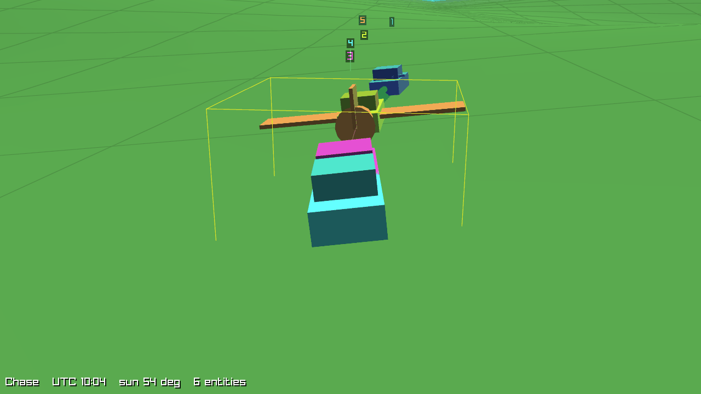
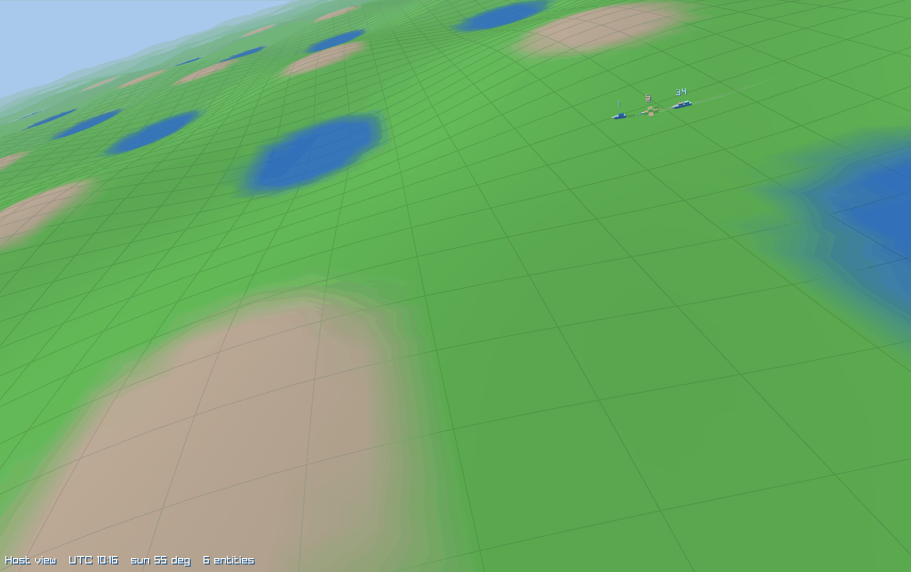
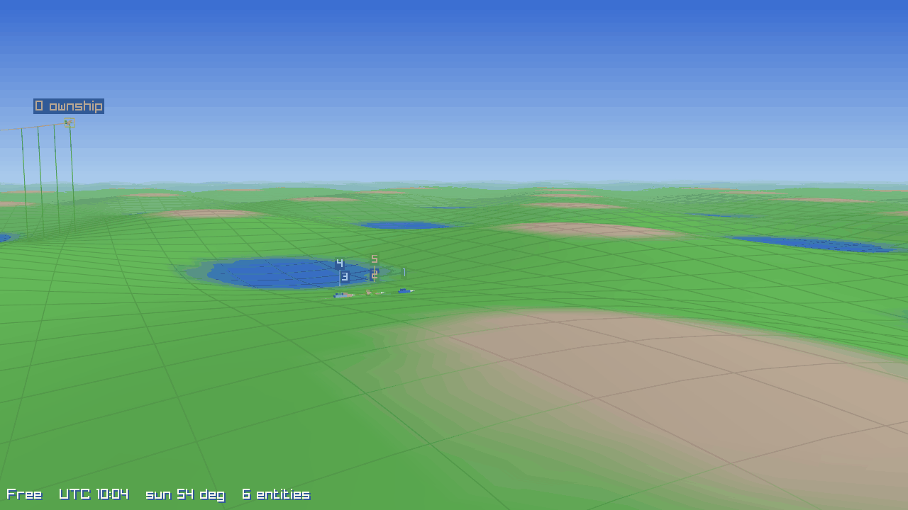
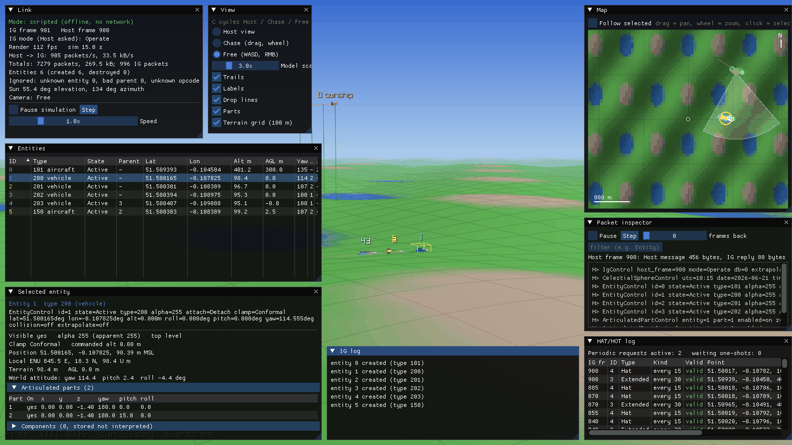

# ig_viewer - the visual mock IG

`ig_viewer` shows what a Host is telling an Image Generator: a 3-D out-the-window view, a top-down
map and debug panels. It is a **test tool**, not a real IG: no terrain database, models or imagery
(the terrain is a synthetic hill pattern, entities are primitive shapes).

Status (task T09b Part 1): the viewer is fed by a built-in **scripted Host** that goes through the
real codec (`MessageBuilder` -> bytes -> `MessageView` -> `Dispatcher` -> `SceneModel`). Network
mode, the Link panel with real session state, and fault injection arrive in Part 2.

The logic lives in the headless library `cigi_mock_ig` (`apps/mock_ig/`, no graphics
dependencies, namespace `cigi::mock`, unit tested). `apps/ig_viewer/` is thin rendering/UI code.

## Build and run

Needs the Homebrew LLVM toolchain (see the top-level README). The viewer is built only when
`CIGI_BUILD_VIEWER=ON`; the `clang-debug` preset turns it on.

    cmake --preset clang-release -DCIGI_BUILD_VIEWER=ON
    cmake --build --preset clang-release --target ig_viewer
    build/clang-release/apps/ig_viewer/ig_viewer --scripted

Dependencies (fetched by CMake, built without warnings and excluded from clang-tidy/coverage):
raylib 6.0, Dear ImGui 1.92.9b, rlImGui (commit 1550009). ImGui is built with 32-bit draw indices
(`ImDrawIdx = unsigned int`) so the map window can hold many entities and trails.

Options:

| Option | Meaning |
|---|---|
| `--scripted` | built-in scripted Host (the only mode in Part 1) |
| `--origin LAT,LON` | scenario centre, degrees (default 51.5,-0.12) |
| `--width N --height N` | window size (default 1280x720, minimum 320x240) |
| `--fullscreen` | start in borderless fullscreen (same as pressing `F`) |
| `--camera host\|chase\|free` | initial camera |
| `--ui none\|map\|all` | panels shown at start |
| `--select ID` | entity selected at start |
| `--start-hour H` | scripted UTC time of day at start (default 10) |
| `--screenshot FILE.png --frames N` | render N frames, save a PNG, exit 0 |
| `--stress N` | add N extra scripted entities, 0..1000 (the Host message must fit one UDP datagram) |
| `--bench N` | render N frames unthrottled and print the frame rate |

## Controls

| Input | Action |
|---|---|
| `C` | cycle camera: Host view, Chase, Free |
| `P` / `N` | pause / single-step the simulation |
| `Tab` | hide / show all panels |
| `F` or `F11` | toggle borderless fullscreen (`Esc` leaves fullscreen; in a window it quits) |
| `L` | reset the panels to the automatic layout |
| Chase: left-drag, wheel | orbit the selected entity, zoom |
| Free: `WASD`, `Q`/`E`, right-drag | fly, down/up, look (`Shift` faster, `Ctrl` slower) |
| Map: drag, wheel, click | pan, zoom, select the nearest entity |
| Entities table: click row | select; columns sort |

Camera modes: **Host view** uses the View Control / View Definition the Host sent (attached
entity, offsets, FOV; falls back to the free camera until one exists), **Chase** orbits the
selected entity, **Free** is a fly camera.

## Panels

- **Link** - mode, IG/Host frame numbers, render fps, packets/s and bytes/s, totals, IG mode the
  Host asked for, count of ignored packets (unknown entity, bad parent, unknown opcode), sun
  position.
- **View** - camera mode and drawing toggles (trails, labels, drop lines, articulated parts,
  100 m terrain grid, model scale).
- **Entities** - sortable table: ID, type, state, parent, lat/lon/alt, AGL, attitude.
- **Selected entity** - last Entity Control (decoded), position, local ENU, terrain height, AGL,
  world attitude, children, articulated parts and components (components are stored, not
  interpreted).
- **Map** - top-down: terrain shading, entity icons with heading (triangle = aircraft, box =
  ground vehicle, disc = other), trails, the Host-view frustum wedge, HAT/HOT probes. "Follow
  selected" keeps the selection centred.
- **Packet inspector** - per frame, every Host packet as one `describe()` line; pause, step back
  through the last ~120 frames, filter by text.
- **HAT/HOT log** - recent requests with kind, period and results.
- **IG log** - entity creation/destruction and ignored packets.

## Window size and fullscreen

The panels are placed from the current window size (`mock::compute_panel_layout`): a left and a
right column at 1100 px wide and above, one column below that. When the window is resized, goes
fullscreen or a panel is shown or hidden, the layout is recomputed and applied once; between
those events you can move and resize panels freely (`L` re-applies the automatic layout). If the
window is too small, the least important panels (IG log, HAT/HOT, inspector, ...) collapse to
their title bar; click the arrow to open one. The native macOS green button is just another
resize; in that mode `F`/`F11`/`Esc` do nothing (GLFW cannot leave a native Space), so leave it
with the green button. Fullscreen is borderless (a window the size of the monitor), which keeps the HiDPI scale.

## What the colours mean

- Each entity has a colour derived from its Entity ID, used for its shape, trail, label and map
  icon. Entity 0 is labelled "ownship".
- Yellow ring / box: selected entity.
- Terrain: blue = water (< 70 m), green = grass, brown = rock (> 130 m); synthetic
  `h = 100 + 40 sin(2 pi lat/0.02) cos(2 pi lon/0.02)` m.
- Probes: green = valid HAT/HOT result (terrain point + requested point), red = invalid.
- Sky and sun direction follow the Celestial Sphere Control time of day (day, dusk, night).
- ID labels are placed so they do not overlap: a label that would collide is lifted (3-D, joined
  to its entity by a leader line) or moved to a free side of its icon (map). With very dense
  scenes some labels are dropped.

## Performance

`ig_viewer --stress 200 --bench 600` (206 entities, 1280x720, unthrottled, macOS, Apple GPU via
deprecated OpenGL):

| Build | fps |
|---|---|
| clang-release | 78 (12.8 ms/frame) |
| clang-debug (unoptimised) | 44 (23 ms/frame) |

The 60 fps target at 200 entities is met in Release. (The ImGui 16-bit index overflow seen under
stress before this fix is gone.)

## Limitations

- Part 1 has no network input; the scripted Host is the only source.
- Flat-earth local frame around the origin (ENU); intended for scenes within a few tens of km.
- Entity shapes are chosen from the Entity Type only (aircraft/vehicle/other); no models.
- OpenGL is deprecated on macOS (raylib still uses it).
- Windows/MSVC is expected to work but is unverified; the Linux build of the viewer is not
  required (`cigi_mock_ig` itself builds everywhere).

Developer note: three hidden options (not in `--help`) exercise the resize paths in offline
captures: `--hidpi` (HiDPI framebuffer, so the PNG is 2x on Retina), `--resize-to WxH` (resize at
frame 3) and `--toggle-fs N` (toggle fullscreen every N frames).
